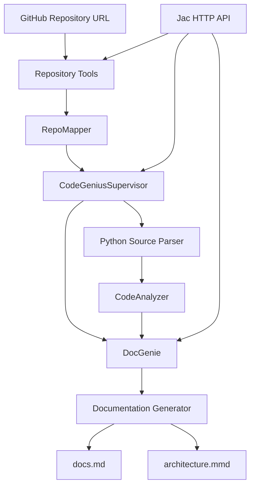

# Codebase Genius

**An Agentic Code-Documentation System built with JacLang and Python**

Codebase Genius analyzes Python repositories, maps their structure, discovers functions and classes, extracts code relationships, and generates Markdown documentation with a Mermaid architecture diagram. Jac walkers coordinate the repository analysis and documentation workflow, while Python modules provide source parsing, repository utilities, and document generation.

## Features

- **Repository mapping:** Validate public GitHub repository URLs, clone repositories, generate file inventories, summarize README files, and count file types.
- **Code analysis:** Parse Python source using the standard-library AST module and discover imports, functions, classes, methods, inheritance, and function-call relationships.
- **Relationship queries:** Filter discovered relationships by symbol and relationship type.
- **Agent orchestration:** Use Jac walkers to coordinate repository mapping, source analysis, entry-point prioritization, and documentation generation.
- **Documentation generation:** Produce a Markdown project report with repository statistics, API references, installation guidance, and a Mermaid architecture diagram.
- **HTTP API:** Expose repository documentation generation through Jac walkers.
- **Testing:** Validate source parsing, repository utilities, and diagram generation with automated Python unit tests.

## Architecture



The workflow combines Jac walkers with Python support modules. The current implementation uses deterministic analysis and heuristic prioritization; it does not require an external LLM API.

## Technology Stack

- **JacLang:** Agent walkers, graph constructs, and HTTP API.
- **Python:** Source analysis and supporting services.
- **Python AST:** Parsing Python syntax and discovering code relationships.
- **Mermaid:** Architecture diagrams.
- **unittest:** Automated Python unit tests.
- **Git:** Source control and repository collaboration.

## Requirements

- Python 3.14, matching the development environment.
- JacLang 0.16.7.
- Git installed and available on your system PATH.
- Internet access when cloning public GitHub repositories.

## Installation on Windows

Open PowerShell in the project directory.

1. Create and activate a virtual environment:

   ```powershell
   python -m venv .venv
   .\.venv\Scripts\Activate.ps1
   ```

2. Install the project dependencies:

   ```powershell
   python -m pip install -r requirements.txt
   ```

3. Confirm the installation:

   ```powershell
   jac --version
   python --version
   ```

## Run the Local Workflow

Run the supervisor and documentation generator against the current project:

```powershell
jac run .\main.jac
```

The generated documentation and architecture diagram are written under:

```text
outputs/<repository_name>/docs.md
outputs/<repository_name>/architecture.mmd
```

## Analyze a Public GitHub Repository

The repository tools support public GitHub HTTPS URLs. For example, the Requests project can be analyzed with the following Jac test script:

```powershell
jac run .\test_code_analyzer.jac
```

The example script currently targets the cloned Requests repository. For a different repository, update the script's `repository_path` to the corresponding local clone path.

Cloned repositories are stored under `outputs/repositories/` by default.

## HTTP API

Start the Jac API server:

```powershell
jac start api.jac
```

In another PowerShell terminal, check the health endpoint:

```powershell
Invoke-RestMethod -Uri "http://localhost:8000/walker/health_check"
```

Submit a public GitHub repository URL for documentation generation:

```powershell
$body = @{
    github_url = "https://github.com/psf/requests"
} | ConvertTo-Json

$response = Invoke-RestMethod `
    -Uri "http://localhost:8000/walker/document_repository" `
    -Method Post `
    -ContentType "application/json" `
    -Body $body

$response | ConvertTo-Json -Depth 15
```

A successful response includes repository details, analysis statistics, priority files, and paths to the generated documentation and diagram.

Only submit repositories you are authorized to access. Public repository cloning requires Git and network access.

## Run Tests

Run the Python unit test suite:

```powershell
python -m unittest discover -s tests -v
```

Check the Jac source files:

```powershell
jac check .\main.jac
jac check .\api.jac
jac check .\agents\repo_mapper.jac
jac check .\agents\code_analyzer.jac
jac check .\agents\doc_genie.jac
jac check .\agents\supervisor.jac
```

## Output Files

For each analyzed repository, Codebase Genius generates:

- `docs.md` — repository overview, statistics, Python API reference, and file inventory.
- `architecture.mmd` — Mermaid diagram of discovered application relationships.

Review generated documentation before publishing it. Automated analysis can miss dynamic behavior, framework-specific wiring, and relationships that cannot be inferred from static Python syntax.

## Current Scope and Limitations

- Static source analysis currently focuses on Python files.
- Jac source files are part of the orchestration layer but are not analyzed by the Python AST parser.
- Relationship discovery is heuristic and does not constitute a complete runtime call graph.
- The priorit